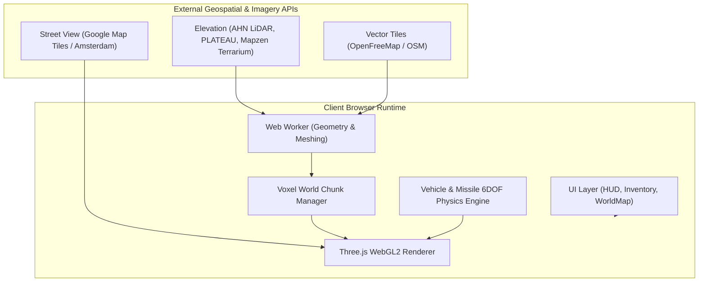

<div align="center">

# 🌍 GeoCrafter

### *GeoGuessr meets Minecraft in the real world*

A high-performance voxel sandbox played inside Google Street View and real-world 360° photospheres. Step through real city streets, build with blocks, drive cars with real-time physics, launch 6DOF guided cruise missiles, and terraform real buildings and terrain.

[](https://threejs.org/)
[](https://vitejs.dev/)
[](https://leafletjs.com/)
[](https://openfreemap.org)
[](LICENSE)
[](https://github.com/furktunay/geocrafter/pulls)

---

**[ English ](README.md)** &nbsp;|&nbsp; **[ Română ](README.ro.md)** &nbsp;|&nbsp; **[ Türkçe ](README.tr.md)**

---

</div>

## 📑 Table of Contents

- [Overview](#overview)
- [Key Features](#key-features)
- [Controls Cheatsheet](#controls-cheatsheet)
  - [🚶 Movement & Exploration](#movement--exploration)
  - [⛏️ Building & Survival](#building--survival)
  - [🚗 Drivable Vehicles](#drivable-vehicles)
  - [🚀 Guided Cruise Missiles](#guided-cruise-missiles)
  - [🗺️ World Map & Utilities](#world-map--utilities)
- [Global Teleportation & World Map](#global-teleportation--world-map)
- [Street View & Photosphere Providers](#street-view--photosphere-providers)
  - [Free Open Data](#free-open-data)
  - [Google Street View (Map Tiles API)](#google-street-view-map-tiles-api)
- [Quick Start & Installation](#quick-start--installation)
- [Architecture & Tech Stack](#architecture--tech-stack)
- [Asset Packs & Customization](#asset-packs--customization)
- [Attributions & Open Data Sources](#attributions--open-data-sources)
- [Legal Disclaimer](#legal-disclaimer)
- [License](#license)

---

## 🌟 Overview

**GeoCrafter** (formerly *Street Craft*) seamlessly blends **real-world 360° street photography** with an interactive **Minecraft-style voxel engine**. 

Standing directly within photographic panoramas, you can step along actual streets, excavate the asphalt, construct towering voxel monuments, detonate explosives against real building facades, drive high-speed cars down boulevards, and pilot guided missiles across city skylines.

The voxel environment is generated dynamically from real-world open geospatial data: building footprints from **OpenStreetMap**, millimeter-precision laser altimetry from **AHN LiDAR** (Netherlands) and **PLATEAU** (Tokyo), and worldwide digital elevation models.

> [!NOTE]
> Created by [furk.ai](https://www.instagram.com/furk.ai/). Formerly known as **Street Craft**.

---

## ✨ Key Features

- **🌐 Dual-World Rendering**: Real-time 360° photographic spherical projection aligned with a live Three.js voxel chunk world.
- **🚗 Drivable Vehicles with Physics**:
  - Full suspension, dynamic steering, drifting, braking, and turbo boost (~137 km/h).
  - 1st-person cockpit & 3rd-person chase cameras.
  - Interactive speedometer HUD and RPM-pitched engine audio.
  - High-velocity collisions and ragdoll physics on hard crashes.
  - Ability to solidify existing parked cars in street photos into destructible 3D voxel blocks.
- **🚀 6DOF Guided Cruise Missiles**:
  - Realistic aerodynamic flight dynamics with continuous roll inertia and flight stabilization.
  - CRT scanline HUD with battery gauge, target crosshair, and nose/chase camera toggle.
  - Smoke & flame particle trails with massive block-destroying blast radius.
- **🗺️ Interactive Leaflet World Map**:
  - Global geocoder: search any city, landmark, or raw GPS coordinates (lat, lon).
  - Multiple map layers: OpenStreetMap (Street), ESRI World Imagery (Satellite), and CartoDB Dark Matter.
  - POI markers (cafes, restaurants, shops, pharmacies) and instant double-click teleportation.
  - One-click presets for cities including Târgu Mureș, Bucharest, Cluj-Napoca, Amsterdam, Paris, New York, Tokyo, Dubai, and more.
- **🔥 Nether Dimension**:
  - Construct upright obsidian frames (2×3 interior) and ignite with Flint & Steel, or drop a Portal Egg.
  - Fully procedural Nether biome with distinctive atmospheric fog, terrain, and netherrack generation.
- **🌲 Dynamic Flora Generation**: Procedural oak and cherry blossom (sakura) trees planted on command.
- **⛏️ Complete Minecraft Mechanics**:
  - Inventory, creative catalog, 2×2 crafting grid, chest storage.
  - Health & hunger status bars, experience levels, damage vignettes, and underwater overlays.
  - Mob spawning (chickens, pigs, sheep, zombies, creepers) with sound effects and custom animations.
  - TNT chain reactions and flint-and-steel ignition.
  - Custom texture pack and audio pack import support.

---

## 🎮 Controls Cheatsheet

### 🚶 Movement & Exploration

| Key / Input | Action |
| :--- | :--- |
| <kbd>W</kbd> | Step forward toward the facing panorama arrow / walk forward |
| <kbd>A</kbd> / <kbd>S</kbd> / <kbd>D</kbd> | Step left, back, or right |
| `Mouse Look` | Look around (click canvas to lock pointer) |
| <kbd>Space</kbd> | Jump (while roaming or in the Nether) |
| <kbd>P</kbd> | Toggle 360° photo background visibility on/off |
| <kbd>F3</kbd> | Toggle debug overlay (coordinates, heading, chunk data, FPS) |

### ⛏️ Building & Survival

| Key / Input | Action |
| :--- | :--- |
| `Left Click` | Break block / Strike mob / Damage solid car |
| `Right Click` | Place block / Interact / Eat food / Open chest / Ignite TNT |
| <kbd>1</kbd> – <kbd>9</kbd> / `Mouse Wheel` | Select hotbar item slot |
| <kbd>E</kbd> | Open Inventory & Crafting window |
| `Bow` + Hold `Right Click` | Draw bow, release to loose arrow |
| `Eggs` + `Right Click` | Spawn passive animals or monsters |
| `TNT` + `Right Click` with Flint & Steel | Prime TNT fuse (detonates after 4 seconds) |
| <kbd>T</kbd> / <kbd>Shift</kbd> + <kbd>T</kbd> | Plant Oak tree / Plant Sakura (Cherry) tree |

### 🚗 Drivable Vehicles

| Key / Input | Action |
| :--- | :--- |
| <kbd>F</kbd> or `Right Click` | Enter or exit nearby car |
| <kbd>B</kbd> | Spawn a new car at player position |
| <kbd>W</kbd> / <kbd>S</kbd> | Accelerate forward / Reverse |
| <kbd>A</kbd> / <kbd>D</kbd> | Steer left / Steer right |
| <kbd>Space</kbd> | Handbrake |
| <kbd>Shift</kbd> | Turbo Boost (up to 137 km/h) |
| <kbd>H</kbd> | Sound car horn |
| <kbd>C</kbd> | Switch camera: 1st-person cockpit ⟷ 3rd-person chase |
| <kbd>R</kbd> | Reset / Flip car upright if overturned |
| <kbd>V</kbd> | Solidify street-view car into destructible 3D voxel mesh |

### 🚀 Guided Cruise Missiles

| Key / Input | Action |
| :--- | :--- |
| <kbd>X</kbd> or `Right Click` (Missile item) | Launch 6DOF guided cruise missile |
| `Mouse Move` | Aerodynamic pitch & yaw steering |
| <kbd>A</kbd> / <kbd>D</kbd> | Roll left / Roll right (rotational inertia) |
| <kbd>W</kbd> / <kbd>Space</kbd> | Engine rocket boost |
| <kbd>S</kbd> | Air brake |
| <kbd>R</kbd> | Dampen / cancel roll velocity |
| <kbd>C</kbd> | Toggle camera (Nose camera ⟷ Exterior tracking) |
| `Left Click` / <kbd>E</kbd> / <kbd>X</kbd> / <kbd>F</kbd> | Detonate warhead manually |
| <kbd>Esc</kbd> / <kbd>Backspace</kbd> | Abort missile flight & return to launch origin |

### 🗺️ World Map & Utilities

| Key / Input | Action |
| :--- | :--- |
| <kbd>M</kbd> | Open / Close Fullscreen World Map |
| <kbd>Shift</kbd> + <kbd>M</kbd> | Toggle mini-map size |
| <kbd>R</kbd> (press twice) | Reset all voxel edits in current location |
| <kbd>G</kbd> | Return from Nether to surface street |

---

## 🗺️ Global Teleportation & World Map

GeoCrafter includes a built-in interactive **Leaflet World Map** accessible anytime by pressing <kbd>M</kbd> or clicking the globe icon on the HUD.

```
┌─────────────────────────────────────────────────────────────┐
│ 🌍 WORLD MAP · Leaflet & OpenStreetMap                      │
├─────────────────────────────────────────────────────────────┤
│ 🔍 [ Search city, landmark, or coordinates... ]             │
│ [🇷🇴 Târgu Mureș] [🇷🇴 București] [🇫🇷 Paris] [🇺🇸 New York]...│
├─────────────────────────────────────────────────────────────┤
│                                                             │
│         [ Satellite / Street / Dark Map Canvas ]            │
│         Double-click anywhere to teleport instantly!        │
│                                                             │
├─────────────────────────────────────────────────────────────┤
│ 📍 Destination: Eiffel Tower, Paris                         │
│ 🚀 [ TELEPORT TO LOCATION ]       ⭐ [ Bookmark Location ]  │
└─────────────────────────────────────────────────────────────┘
```

- **Instant Teleportation**: Double-click anywhere on planet Earth to immediately load street-level photospheres and local topography.
- **Search Geocoder**: Type any query (e.g., `"Times Square"`, `"Colosseum Rome"`, `"Strada Mihai Viteazul, Târgu Mureș"`, or `"46.5465, 24.5687"`).
- **Multiple Layers**: Toggle between OpenStreetMap street tiles, high-resolution ESRI satellite photography, and CartoDB dark mode.
- **Points of Interest**: Displays nearby restaurants, cafes, pharmacies, and landmarks directly on the map.

---

## 🌐 Street View & Photosphere Providers

### Free Open Data
Out of the box, GeoCrafter works without any API keys for supported open datasets:
- **Amsterdam**: High-resolution 8000px municipal survey panoramas spaced every 5 meters, aligned with AHN airborne laser altimetry.
- **Panoramax**: Open crowd-sourced panoramic photography.

### Google Street View (Map Tiles API)
To explore almost every paved road and city across the globe in crisp imagery:

1. Go to the [Google Cloud Console](https://console.cloud.google.com/) and create a project with billing enabled.
2. Enable the **Map Tiles API**.
3. Create an **API Key** (recommended: restrict it to the Map Tiles API and your local origin `http://localhost:5173/*`).
4. In the game title menu or pause screen: navigate to **Options → Google Street View**, paste your key, and check **Use Google Street View**.

> [!TIP]
> **Safety & Quota Management**:
> - Your API key is stored strictly inside your local browser `localStorage`—it is never transmitted to any third-party server or bundled into builds.
> - Google provides the first **100,000 Street View tiles per month free of charge**.
> - GeoCrafter includes a safety cutoff that automatically halts requests at **90,000 tiles/month** unless manually adjusted in the Options menu.

---

## 🚀 Quick Start & Installation

### Prerequisites
- [Node.js](https://nodejs.org) (version 20 or newer recommended)
- `npm` (bundled with Node.js) or `pnpm` / `yarn`
- Modern browser with WebGL2 support (Chrome, Firefox, Edge, Safari)

### Step-by-Step Setup

1. **Clone the repository**:
   ```bash
   git clone https://github.com/furktunay/geocrafter.git
   cd geocrafter
   ```

2. **Install dependencies**:
   ```bash
   npm install
   ```

3. **Start the development server**:
   ```bash
   npm run dev
   ```

4. **Launch the game**:
   Open [http://localhost:5173](http://localhost:5173) in your browser.

### Available Scripts

| Command | Purpose |
| :--- | :--- |
| `npm run dev` | Starts Vite local development server with hot module replacement |
| `npm run build` | Bundles and minifies the application for production deployment in `/dist` |
| `npm run preview` | Serves the production build locally for verification |
| `npm run sounds` | Copies audio files from custom pack into `public/sounds` |
| `npm run textures` | Copies block textures into `public/textures` |
| `npm run sounds:prune` | Removes unused audio files from the pack directory |
| `npm run textures:prune` | Removes unused textures from the pack directory |

---

## 🏗️ Architecture & Tech Stack

GeoCrafter is built using modern browser APIs and native ES modules:



- **3D Graphics Engine**: [Three.js](https://threejs.org/) (r186) with custom shaders, dynamic frustum culling, and ambient occlusion.
- **Geospatial Processing**:
  - [Leaflet](https://leafletjs.com/) for interactive global navigation and POI display.
  - [Proj4js](https://github.com/proj4js/proj4js) for on-the-fly coordinate reference system (CRS) reprojections (EPSG:4326, EPSG:28992, EPSG:3857).
  - [@mapbox/vector-tile](https://github.com/mapbox/vector-tile) & [Pbf](https://github.com/mapbox/pbf) for decoding OpenStreetMap vector building footprints and road polylines.
  - [geotiff](https://github.com/geotiffjs/geotiff.js) for high-resolution digital elevation models.
- **Voxel Engine**: Multithreaded chunk generation via Web Workers, greedy meshing, and fast raycasting.
- **Vehicle Simulation**: Custom rigid-body vehicle dynamics with steering curves, tire grip simulation, and Draco-compressed GLTF models.

---

## 🎨 Asset Packs & Customization

You can personalize GeoCrafter with your own Minecraft textures or sounds:

1. Place your extracted vanilla or custom Minecraft Java resource pack into the project root.
2. Run texture and sound extractors:
   ```bash
   npm run textures
   npm run sounds
   ```
3. The scripts automatically map Minecraft PNGs and OGG sounds to GeoCrafter's block and item registry.

---

## ⚖️ Attributions & Open Data Sources

GeoCrafter stands on the shoulders of open geospatial datasets:

- **Amsterdam Panoramas**: Open data provided by [Gemeente Amsterdam](https://api.data.amsterdam.nl/panorama/).
- **Elevation Data (Netherlands)**: [AHN](https://www.ahn.nl) (Actueel Hoogtebestand Nederland via PDOK).
- **Building Footprints (Netherlands)**: [3D BAG](https://3dbag.nl) by TU Delft, licensed under [CC BY 4.0](https://creativecommons.org/licenses/by/4.0/).
- **Tokyo 3D Buildings**: [Project PLATEAU](https://www.mlit.go.jp/plateau/) by the Ministry of Land, Infrastructure, Transport and Tourism (MLIT) of Japan.
- **Worldwide Roads, Water & Infrastructure**: © [OpenStreetMap](https://www.openstreetmap.org/copyright) contributors, served through [OpenFreeMap](https://openfreemap.org).
- **Global Elevation Fallback**: Mapzen Terrarium on AWS Open Data & GSI Japan.
- **Volunteer Panoramas**: [Panoramax](https://panoramax.fr) contributors, licensed under [CC BY-SA 4.0](https://creativecommons.org/licenses/by-sa/4.0/).
- **Street View Imagery**: © Google, rendered through the Map Tiles API with the player's private API key.
- **Menu Typography**: [Jersey 15](https://fonts.google.com/specimen/Jersey+15) by Google Fonts, SIL Open Font License.

---

## ⚠️ Legal Disclaimer

**GeoCrafter is an independent, experimental fan project.**
- Not an official Minecraft product.
- Not approved by, sponsored by, or associated with Mojang Studios or Microsoft Corporation.
- Not affiliated with Google LLC or GeoGuessr AB.
- All trademarks and registered trademarks are the property of their respective owners.

---

## 📄 License

This project is open-source software licensed under the **[MIT License](LICENSE)**.
Feel free to study, modify, and build upon the code. Pull requests and issues are warmly welcome!
