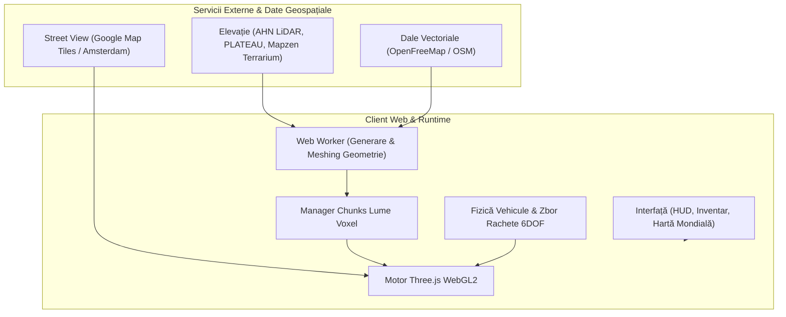

<div align="center">

# 🌍 GeoCrafter

### *GeoGuessr se întâlnește cu Minecraft în lumea reală*

Un sandbox voxel de înaltă performanță jucat direct în Google Street View și fotografii stradale panoramice 360°. Pășește pe străzile reale ale orașelor, construiește din blocuri, condu mașini cu fizică în timp real, lansează rachete ghidate 6DOF și remodelează clădirile și relieful real.

[](https://threejs.org/)
[](https://vitejs.dev/)
[](https://leafletjs.com/)
[](https://openfreemap.org)
[](LICENSE)
[](https://github.com/furktunay/geocrafter/pulls)

---

**[ English ](README.md)** &nbsp;|&nbsp; **[ Română ](README.ro.md)** &nbsp;|&nbsp; **[ Türkçe ](README.tr.md)**

---

</div>

## 📑 Cuprins

- [Prezentare generală](#prezentare-generală)
- [Funcționalități principale](#funcționalități-principale)
- [Ghid comenzi & taste](#ghid-comenzi--taste)
  - [🚶 Mișcare & Explorare](#mișcare--explorare)
  - [⛏️ Construcție & Supraviețuire](#construcție--supraviețuire)
  - [🚗 Vehicule & Conducere](#vehicule--conducere)
  - [🚀 Rachete de croazieră ghidate (6DOF)](#rachete-de-croazieră-ghidate-6dof)
  - [🗺️ Hartă mondială & Utilitare](#hartă-mondială--utilitare)
- [Teleportare globală & Harta Mondială](#teleportare-globală--harta-mondială)
- [Surse Street View & Panorame 360°](#surse-street-view--panorame-360)
  - [Date deschise gratuite](#date-deschise-gratuite)
  - [Google Street View (Map Tiles API)](#google-street-view-map-tiles-api)
- [Instalare & Rulare rapidă](#instalare--rulare-rapidă)
- [Arhitectură & Tehnologii](#arhitectură--tehnologii)
- [Pachete de texturi & Sunete](#pachete-de-texturi--sunete)
- [Surse de date & Mulțumiri](#surse-de-date--mulțumiri)
- [Notă legală](#notă-legală)
- [Licență](#licență)

---

## 🌟 Prezentare generală

**GeoCrafter** (cunoscut anterior ca *Street Craft*) îmbină **fotografia stradală panoramică 360° din lumea reală** cu un **motor de cuburi voxel stil Minecraft**.

Stând direct în interiorul fotografiilor panoramice, poți păși de pe o stradă pe alta, poți excava asfaltul, poți ridica structuri din blocuri, poți detona explozibili pe fațadele clădirilor reale, poți conduce mașini pe bulevarde și poți pilota rachete ghidate peste acoperișurile orașelor.

Relieful și clădirile voxel sunt generate procedural în timp real din date geospațiale deschise: amprentele clădirilor din **OpenStreetMap**, scanări laser cu altimetrie milimetrică din **AHN LiDAR** (Olanda) și **PLATEAU** (Tokyo), precum și modele digitale globale de elevație.

> [!NOTE]
> Proiect experimental creat de [furk.ai](https://www.instagram.com/furk.ai/). Denumit inițial **Street Craft**.

---

## ✨ Funcționalități principale

- **🌐 Randare Dual-World**: Proiecție sferică fotorealistă 360° sincronizată în timp real cu o lume Three.js din chunk-uri voxel.
- **🚗 Mașini funcționale cu fizică avansată**:
  - Suspensie dinamică, virare, derapaje (drift), frână și turbo boost (~137 km/h).
  - Camere comutabile: perspectivă din cockpit (First-Person) și vedere exterioară (Third-Person).
  - Vitezometru digital integrat în HUD și sunete de motor sincronizate cu turația (RPM).
  - Coliziuni la viteză mare și fizică ragdoll în caz de impact puternic sau ejectare.
  - Conversia mașinilor statice din pozele stradale în blocuri 3D fizice și distrugibile (<kbd>V</kbd>).
- **🚀 Rachete ghidate 6DOF (Cruise Missiles)**:
  - Fizică aerodinamică realistă cu inerție de ruliu continuă și stabilizare de zbor.
  - HUD tactic stil CRT militar cu linii de scanare, indicator de semnal/baterie și reticulă de țintire.
  - Dare vizuale de fum și flăcări cu explozii masive capabile să niveleze clădiri întregi.
- **🗺️ Hartă Mondială interactivă (Leaflet)**:
  - Căutare globală integrată: caută orice oraș, stradă, monument sau coordonate GPS (lat, lon).
  - Straturi multiple: Stradal (OpenStreetMap), Satelit de înaltă rezoluție (ESRI) și Mod Întunecat (CartoDB Dark).
  - Puncte de interes (POI): cafenele, restaurante, farmacii, magazine și repere turistice.
  - Teleportare instantanee prin dublu-click oriunde pe glob.
  - Scurtături cu salt rapid pentru orașe din România (🇷🇴 Târgu Mureș, București, Cluj-Napoca, Brașov, Constanța, Timișoara) și metropole internaționale (Paris, Londra, Roma, New York, Tokyo, Dubai etc.).
- **🔥 Dimensiunea Nether**:
  - Construiește un portal vertical din obsidian (2×3 spațiu interior) și aprinde-l cu cremene și oțel, sau plasează un Ou de Portal.
  - Mediu Nether procedural complet cu ceață densă specifică, netherrack și mecanici de teleportare.
- **🌲 Plantare dinamică de copaci**: Generează stejari masivi sau cireși înfloriți (sakura) la cerere.
- **⛏️ Mecanici complete de Minecraft**:
  - Inventar, catalog de creativ, grilă de crafting 2×2, cufere pentru depozitare.
  - Bare de viață și hrană, puncte de experiență și niveluri, efecte de daune și randare subacvatică.
  - Mobs (găini, porci, oi, zombi, creeperi) cu animații și sunete specifice.
  - Reacții în lanț cu TNT și aprindere cu amnar.
  - Suport pentru importul de pachete de texturi și sunete personalizate din Minecraft Java.

---

## 🎮 Ghid comenzi & taste

### 🚶 Mișcare & Explorare

| Tastă / Acțiune | Funcție |
| :--- | :--- |
| <kbd>W</kbd> | Pas înainte către săgeata fotogramei / mers înainte |
| <kbd>A</kbd> / <kbd>S</kbd> / <kbd>D</kbd> | Pas la stânga, înapoi sau la dreapta |
| `Mișcare mouse` | Orientare privire (click pe ecran pentru blocare cursor) |
| <kbd>Space</kbd> | Săritură (în modul liber de mers sau în Nether) |
| <kbd>P</kbd> | Activează / dezactivează fundalul foto 360° |
| <kbd>F3</kbd> | Ecran de depanare (coordonate XYZ, chunk, orientare, FPS) |

### ⛏️ Construcție & Supraviețuire

| Tastă / Acțiune | Funcție |
| :--- | :--- |
| `Click Stânga` | Sparge bloc / Lovește inamici / Avariere vehicul |
| `Click Dreapta` | Pune bloc / Interacționează / Mănâncă / Deschide cufăr / Aprinde TNT |
| <kbd>1</kbd> – <kbd>9</kbd> / `Rotiță mouse` | Selectează slotul din bara rapidă (hotbar) |
| <kbd>E</kbd> | Deschide inventarul și grila de crafting |
| `Arc` + Ține `Click Dreapta` | Întinde arcul; eliberează pentru a trage |
| `Ouă de spawn` + `Click Dreapta` | Spawnează creaturi și animale |
| `TNT` + `Click Dreapta` cu Amnar | Aprinde fitilul TNT (detonează după 4 secunde) |
| <kbd>T</kbd> / <kbd>Shift</kbd> + <kbd>T</kbd> | Plantează stejar / Plantează cireș (sakura) |

### 🚗 Vehicule & Conducere

| Tastă / Acțiune | Funcție |
| :--- | :--- |
| <kbd>F</kbd> sau `Click Dreapta` | Urcă sau coboară din mașina din apropiere |
| <kbd>B</kbd> | Spawnează o mașină nouă în fața ta |
| <kbd>W</kbd> / <kbd>S</kbd> | Accelerație înainte / Marșarier |
| <kbd>A</kbd> / <kbd>D</kbd> | Virează stânga / Virează dreapta |
| <kbd>Space</kbd> | Frână de mână |
| <kbd>Shift</kbd> | Turbo Boost (până la ~137 km/h) |
| <kbd>H</kbd> | Claxon |
| <kbd>C</kbd> | Schimbă camera: Cockpit (interior) ⟷ Urmărire (exterior) |
| <kbd>R</kbd> | Repune mașina pe roți dacă s-a răsturnat |
| <kbd>V</kbd> | Transformă o mașină din poza stradală într-un obiect 3D solid și distrugibil |

### 🚀 Rachete de croazieră ghidate (6DOF)

| Tastă / Acțiune | Funcție |
| :--- | :--- |
| <kbd>X</kbd> sau `Click Dreapta` (cu racheta în mână) | Lansează racheta ghidată |
| `Mișcare mouse` | Virare aerodinamică (tangaj & girație fluide) |
| <kbd>A</kbd> / <kbd>D</kbd> | Ruliu stânga / Ruliu dreapta (inerție de rotație) |
| <kbd>W</kbd> / <kbd>Space</kbd> | Postcombustie / Boost de viteză |
| <kbd>S</kbd> | Frână aerodinamică |
| <kbd>R</kbd> | Oprește rotația / stabilizează aripile |
| <kbd>C</kbd> | Schimbă perspectiva (Cameră din vârful rachetei ⟷ Cameră din spate) |
| `Click Stânga` / <kbd>E</kbd> / <kbd>X</kbd> / <kbd>F</kbd> | Detonare manuală a încărcăturii |
| <kbd>Esc</kbd> / <kbd>Backspace</kbd> | Anulează zborul și teleportează jucătorul înapoi la locul de lansare |

### 🗺️ Hartă mondială & Utilitare

| Tastă / Acțiune | Funcție |
| :--- | :--- |
| <kbd>M</kbd> | Deschide / Închide Harta Mondială |
| <kbd>Shift</kbd> + <kbd>M</kbd> | Mărește sau micșorează minimap-ul din HUD |
| <kbd>R</kbd> (apăsat de două ori) | Resetează toate modificările de blocuri din harta curentă |
| <kbd>G</kbd> | Întoarcere din Nether înapoi pe stradă |

---

## 🗺️ Teleportare globală & Harta Mondială

GeoCrafter include o **Hartă Mondială interactivă bazată pe Leaflet**, accesibilă oricând prin tasta <kbd>M</kbd> sau prin butonul dedicat de pe ecran.

- **Teleportare prin dublu-click**: Fă dublu-click oriunde pe glob pentru a descărca panoramele stradale și topografia zonei respective.
- **Motor de căutare**: Caută direct după denumire sau coordonate (ex: *"Turnul Eiffel"*, *"Colosseum Roma"*, *"Strada Mihai Viteazul, Târgu Mureș"*, sau *"46.5465, 24.5687"*).
- **Straturi multiple de vizualizare**: Comută între harta rutieră OpenStreetMap, imagini din satelit de înaltă rezoluție (ESRI) și mod de noapte (CartoDB Dark).
- **Puncte de interes (POI)**: Evidențiază restaurante, cafenele, farmacii și obiective turistice direct pe hartă.

---

## 🌐 Surse Street View & Panorame 360°

### Date deschise gratuite
Din start, GeoCrafter funcționează fără nicio cheie API pentru locațiile cu date deschise:
- **Amsterdam**: Panorame municipale de 8000px realizate din 5 în 5 metri, corelate cu scanările laser AHN.
- **Panoramax**: Bază de date fotografică deschisă și colaborativă.

### Google Street View (Map Tiles API)
Pentru a explora practic orice oraș și șosea de pe planetă în rezoluție maximă:

1. Intră în [Google Cloud Console](https://console.cloud.google.com/) și configurează un proiect cu facturare activată.
2. Activează serviciul **Map Tiles API**.
3. Generează o **cheie API** (este recomandat să o restricționezi la Map Tiles API și la adresa locală `http://localhost:5173/*`).
4. În meniul jocului: mergi la **Options → Google Street View**, lipește cheia și bifează **Use Google Street View**.

> [!TIP]
> **Securitate & Protecție costuri**:
> - Cheia ta API este salvată exclusiv în browserul tău (`localStorage`)—nu este trimisă niciodată către servere externe și nu este inclusă în codul compilat.
> - Google oferă primele **100.000 de dale Street View pe lună în mod gratuit**.
> - Jocul include o limită de siguranță automată care oprește încărcarea la **90.000 dale/lună**, pentru a preveni orice costuri neprevăzute.

---

## 🚀 Instalare & Rulare rapidă

### Cerințe de sistem
- [Node.js](https://nodejs.org) (versiunea 20 sau mai nouă)
- `npm` (instalat automat cu Node.js), `pnpm` sau `yarn`
- Browser modern compatibil WebGL2 (Google Chrome, Mozilla Firefox, Microsoft Edge, Safari)

### Pași de instalare

1. **Clonează depozitul de cod**:
   ```bash
   git clone https://github.com/furktunay/geocrafter.git
   cd geocrafter
   ```

2. **Instalează dependințele**:
   ```bash
   npm install
   ```

3. **Pornește serverul de dezvoltare**:
   ```bash
   npm run dev
   ```

4. **Joacă în browser**:
   Deschide adresa afișată în consolă (de regulă [http://localhost:5173](http://localhost:5173)).

### Comenzi disponibile

| Comandă | Descriere |
| :--- | :--- |
| `npm run dev` | Pornește serverul Vite de dezvoltare cu Hot Module Replacement |
| `npm run build` | Compilează și optimizează proiectul pentru producție în directorul `/dist` |
| `npm run preview` | Testează versiunea de producție local |
| `npm run sounds` | Extrage fișierele audio dintr-un pachet de resurse în `public/sounds` |
| `npm run textures` | Copiază texturile blocurilor în `public/textures` |
| `npm run sounds:prune` | Șterge sunetele neutilizate din pachet |
| `npm run textures:prune` | Șterge texturile neutilizate din pachet |

---

## 🏗️ Arhitectură & Tehnologii



- **Motor Grafic 3D**: [Three.js](https://threejs.org/) (r186) cu shadere personalizate, frustum culling dinamic și ocluzie ambientală (AO).
- **Procesare Geospațială**:
  - [Leaflet](https://leafletjs.com/) pentru navigarea pe glob și reprezentarea POI.
  - [Proj4js](https://github.com/proj4js/proj4js) pentru conversia coordonatelor în proiecțiile locale cartografice (EPSG:4326, EPSG:28992, EPSG:3857).
  - [@mapbox/vector-tile](https://github.com/mapbox/vector-tile) & [Pbf](https://github.com/mapbox/pbf) pentru decodarea vectorilor OpenStreetMap (clădiri și șosele).
  - [geotiff](https://github.com/geotiffjs/geotiff.js) pentru citirea modelelor digitale de teren (DEM/LiDAR).
- **Lume Voxel**: Generare pe fir de execuție separat (Web Worker), algoritm greedy meshing și raycasting rapid.
- **Simulare Vehicule**: Dinamică rigid-body adaptată, virare neliniară, fricțiune a anvelopelor și modele 3D GLTF optimizate cu Draco.

---

## 🎨 Pachete de texturi & Sunete

Poți adăuga texturi și sunete din pachetele de resurse oficiale sau create de comunitate:

1. Dezarhivează fișierele unui resource pack de Minecraft Java în rădăcina proiectului.
2. Rulează comenzile de mapare:
   ```bash
   npm run textures
   npm run sounds
   ```
3. Scripturile vor asocia automat fișierele PNG și OGG cu blocurile și elementele din GeoCrafter.

---

## ⚖️ Surse de date & Mulțumiri

- **Panorame Amsterdam**: Date deschise oferite de [Gemeente Amsterdam](https://api.data.amsterdam.nl/panorama/).
- **Date de Elevație (Olanda)**: [AHN](https://www.ahn.nl) (Actueel Hoogtebestand Nederland prin PDOK).
- **Clădiri 3D (Olanda)**: [3D BAG](https://3dbag.nl) de TU Delft, licențiat [CC BY 4.0](https://creativecommons.org/licenses/by/4.0/).
- **Clădiri 3D Tokyo**: [Project PLATEAU](https://www.mlit.go.jp/plateau/) de MLIT Japonia.
- **Șosele, ape și infrastructură**: © Contribuitorii [OpenStreetMap](https://www.openstreetmap.org/copyright), furnizate prin [OpenFreeMap](https://openfreemap.org).
- **Elevație globală**: Mapzen Terrarium pe AWS Open Data & GSI Japonia.
- **Panorame voluntare**: Contribuitorii [Panoramax](https://panoramax.fr), licențiat [CC BY-SA 4.0](https://creativecommons.org/licenses/by-sa/4.0/).
- **Google Street View**: © Google, afișat prin Map Tiles API folosind cheia privată a jucătorului.
- **Font Meniu**: [Jersey 15](https://fonts.google.com/specimen/Jersey+15), SIL Open Font License.

---

## ⚠️ Notă legală

**GeoCrafter este un proiect experimental independent non-comercial.**
- Nu este un produs oficial Minecraft.
- Nu este aprobat, sponsorizat sau asociat cu Mojang Studios sau Microsoft Corporation.
- Nu este afiliat cu Google LLC sau GeoGuessr AB.
- Toate mărcile înregistrate aparțin proprietarilor de drept.

---

## 📄 Licență

Acest proiect este software open-source publicat sub **[Licența MIT](LICENSE)**.
Ești liber să studiezi, să modifici și să extinzi codul. Contribuțiile prin Pull Request sunt binevenite!
